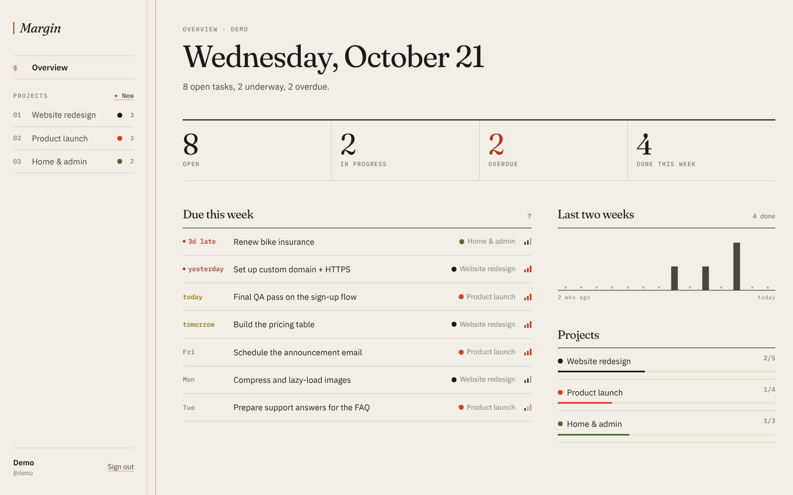
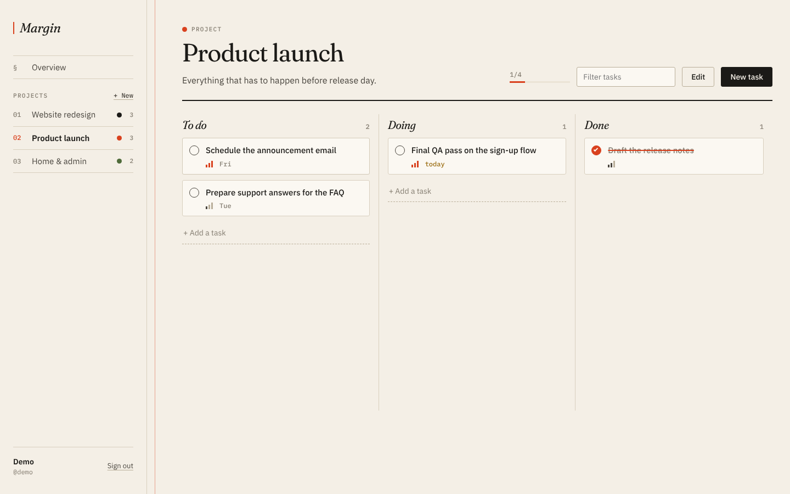
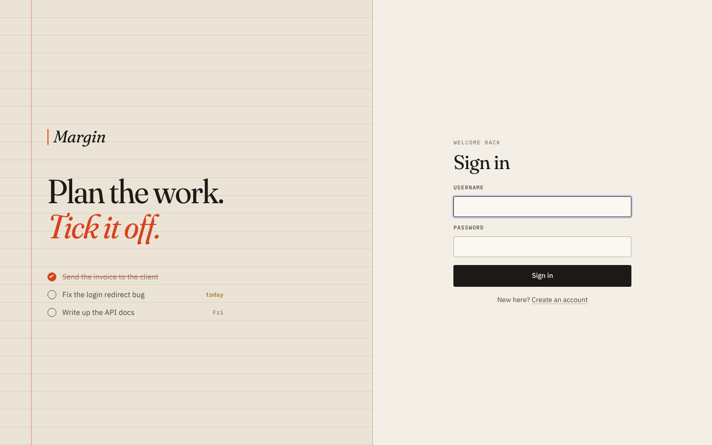
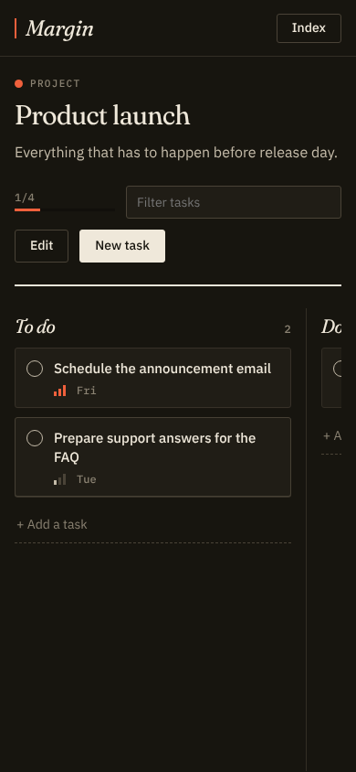

# Margin

A project and task tracker built with Django REST Framework and React.
Create projects, put tasks on a board, drag them from To do to Done, and use the overview page to see what's due and what's late.

| Board | Sign in | Mobile, dark mode |
| --- | --- | --- |
|  |  |  |

## Features

- **Accounts:** register, sign in and sign out with token authentication. Tokens expire after 7 days, passwords go through Django's validators, and login is rate limited.
- **Projects:** create, rename, recolour and delete. Each one shows live counts of open, done and overdue tasks.
- **Board:** To do / Doing / Done columns with drag-and-drop ordering that is saved on the server, quick add, a filter box, and a dialog for notes, priority and due date.
- **Overview:** open, in-progress, overdue and done-this-week totals, tasks due in the next 7 days, a 14-day completion chart, and progress per project.
- **Private by default:** every query is scoped to the signed-in user, and the tests check that you can't read or change anyone else's data.
- **Responsive and accessible:** works down to phone width, follows the system light or dark theme, has keyboard-friendly dialogs, and respects reduced motion.

## Built with

- **Backend:** Django and Django REST Framework
- **Frontend:** React and Vite, with hand-written CSS
- **Database:** SQLite, MySQL or PostgreSQL
- **Shipping:** Docker, GitHub Actions

## Design

The interface is styled like a paper notebook: warm paper and ink colours, one vermilion accent, Fraunces for headings, IBM Plex Sans and Mono for text and numbers, ruled lines instead of shadowed cards, and a red margin rule down the page. All colours and type sizes live in `frontend/src/styles/tokens.css`, and dark mode just redefines those tokens.
